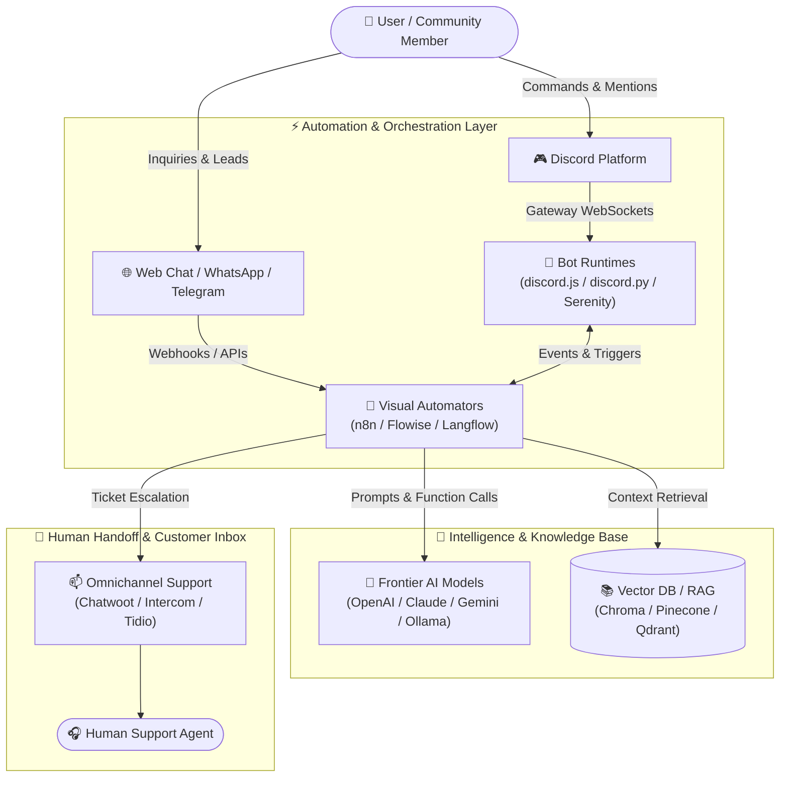

# 🤖 Awesome Chatbot & Discord Bot Automation 🚀

<p align="center">
  
</p>

<p align="center">
  <a href="https://github.com/ishandutta2007/Awesome-Awesome-Awesome"></a><a href="https://discord.gg/jc4xtF58Ve"></a>
  
  
  
  
  <a href="https://github.com/ishandutta2007"></a>
</p>

---

## 🧭 Curated Directory of SaaS Chat Platforms & Open-Source Bot Frameworks

> **The definitive collection of enterprise SaaS conversational platforms, Discord bot runtimes, LLM agent workflows, visual dialog builders, and self-hosted live-chat customer automation suites.**

Welcome to the **Awesome Chatbot & Discord Bot Automation** ecosystem. Whether you are building an AI-powered community moderation bot on Discord, orchestrating autonomous multi-agent customer workflows, or deploying omnichannel e-commerce lead funnels across WhatsApp, Telegram, Slack, and web chat, this curated guide benchmarks the entire conversational technology stack.

---

## 📑 Table of Contents

- [📊 Sector Overview & Market Dynamics](#-sector-overview--market-dynamics)
- [💼 SaaS & Hosted Conversational Platforms](#-saas--hosted-conversational-platforms)
- [🔓 Open-Source GitHub Projects & Frameworks](#-open-source-github-projects--frameworks)
- [🛠️ Architecture & Integration Guide](#️-architecture--integration-guide)
- [🤝 How to Contribute](#-how-to-contribute)
- [💖 Support & Sponsor](#-support--sponsor)
- [📈 Star History](#-star-history)
- [⚖️ Disclaimer](#️-disclaimer)

---

## 📊 Sector Overview & Market Dynamics

The global conversational AI and chatbot market was estimated at **$14.8 billion in 2025** and is projected to expand rapidly beyond **$41 billion to $82 billion by 2030–2034**, clocking a compound annual growth rate (CAGR) of approximately **23.5%**.

The market structure exhibits a pronounced dual-layered dynamic: it is **highly concentrated at the foundational infrastructure layer**—where a handful of tech giants and frontier labs (OpenAI, Microsoft, Google, Anthropic, Meta) dominate underlying LLMs and compute—while remaining **moderately to highly fragmented across the application and workflow orchestration layer**, where thousands of specialized SaaS vendors, vertical customer support platforms, no-code visual bot builders, and open-source frameworks compete dynamically without a single "winner-take-all" outcome.

---

## 💼 SaaS & Hosted Conversational Platforms

Below is the verified competitive benchmark for leading commercial SaaS chatbot and messaging automation platforms, sorted in descending order by estimated company valuation / annual revenue scale.

| Platform / Product | Company Scale (Valuation / Revenue) 🏢 | Starting Tier Pricing 🏷️ | Free Tier / Trial Limits ⏳ | Key Capabilities & Channel Focus 🌐 |
| :--- | :--- | :--- | :--- | :--- |
| **[Intercom (Fin AI)](https://intercom.com)** | **$3.6B Valuation** *(Acquired by Salesforce, ~$400M ARR)* | **$39/seat/month** *(Essential tier; AI Fin bot billed at $0.99/resolved conversation)* | **14-day free trial** *(Includes access to core inbox, ticketing, and limited Fin AI resolutions; no credit card upfront)* | Omnichannel enterprise customer messaging, autonomous Fin resolution bot, live-chat tickets, and proactive product tours. |
| **[Drift (Salesloft)](https://salesloft.com)** | **$500M Valuation** *(Acquired by Vista/Salesloft; ~$80M-$100M ARR)* | **$2,500/month** *(Billed annually for Premium conversational marketing & routing)* | **60-day free trial** *(Interactive sandbox & sales tour with limited lead-routing tests; strictly time-capped)* | Enterprise conversational marketing, AI pipeline acceleration, automated account-based meeting booking, and CRM lead routing. |
| **[LivePerson](https://liveperson.com)** | **$243.7M Revenue** *(Public: NASDAQ: LPSN; ~$46M Market Cap)* | **$599/month** *(Standard starter plan for conversational cloud messaging)* | **14-day free trial** *(Full access to Conversational Cloud studio, mock customer routing, and bot simulator)* | Enterprise-grade conversational cloud handling high-concurrency customer engagement across SMS, Apple Messages, and web. |
| **[ManyChat](https://manychat.com)** | **$140M Series B** *(~$35M-$75M estimated ARR)* | **$15/month** *(Pro plan starting at 500 active contacts)* | **Free forever plan** *(Strictly capped at 25 monthly active contacts, 2 channels, 1 team seat, and 4 active automations)* | Social-first conversational marketing automation, Instagram DM auto-replies, TikTok lead funnels, and Telegram messaging. |
| **[Botpress Cloud](https://botpress.com)** | **$120M Valuation** *(Series B; >$10M estimated ARR)* | **$150/month** *(Plus tier; includes 250 conversations and $25/mo AI credit budget)* | **Free forever plan** *(Capped at 100 conversations/month, 3 AI bots, 3 collaborator seats, and $5 one-time AI credits)* | Next-gen LLM autonomous agent builder, visual flow orchestrator, native RAG knowledge bases, and Discord/WhatsApp integration. |
| **[Voiceflow](https://voiceflow.com)** | **$105M Valuation** *(Series B; ~$10M-$16M estimated ARR)* | **$50/month** *(Pro plan; includes up to 20 agents and 1 editor seat)* | **Free forever plan** *(Capped at 2 AI assistant projects, 1 editor seat, and a one-time allotment of 100 testing credits)* | Visual collaborative conversational design, interactive voice/chat prototyping, LLM prompt engineering, and API webhooks. |
| **[Tidio (Lyro AI)](https://tidio.com)** | **$100M+ Implied Valuation** *(Series B; ~$38M-$48M estimated ARR)* | **$29/month** *(Starter plan; 100 handled conversations and live visitor monitoring)* | **Free forever plan** *(Capped at 50 handled conversations/month, 100 rule-based flow triggers, and a one-time 50 Lyro AI chats)* | E-commerce live chat widget, Lyro LLM automated customer support, abandoned cart recovery, and Instagram/WhatsApp inbox. |
| **[Landbot](https://landbot.io)** | **$10.2M Raised** *(Series A; ~$5.2M-$7.3M estimated ARR)* | **€40/month** *(Starter plan; approx $43/mo for 500 monthly chats)* | **Free forever Sandbox** *(Capped at 100 chats/month, 1 user seat, web-only embed, and 0 AI reasoning chats)* | Interactive conversational website forms, no-code visual bot flows, lead qualification funnels, and WhatsApp Business API. |
| **[Chatfuel](https://chatfuel.com)** | **$6.7M Raised** *(~$4M-$8M estimated ARR)* | **$20/month** *(Business tier; includes $20/mo bundled AI credits and unlimited contacts)* | **Free forever Light plan** *(Capped at basic rule-based comment triggers/replies on IG/FB; excludes WhatsApp and AI models)* | Social e-commerce chatbot builder, comment-to-DM triggers, visual broadcast sequencing, and multi-channel customer inbox. |
| **[Customers.ai (MobileMonkey)](https://customers.ai)** | **$5M Series A** *(~$2M estimated ARR)* | **$99/month** *(Website visitor identification and multi-channel marketing pixel)* | **7-day free trial** *(Includes testing identity resolution with up to 500 captured website visitors; no permanent free tier)* | B2B/B2C website visitor identity resolution (X-Ray pixel), automated email re-engagement, and multi-channel conversational ads. |

---

## 🔓 Open-Source GitHub Projects & Frameworks

A rich ecosystem of self-hosted, developer-friendly open-source repositories for building custom Discord bots, autonomous LLM agents, and omnichannel conversational desks. Sorted in descending order by GitHub stargazer count.

| Project / Repository | GitHub_Stars_Badge ⭐ | Runtime / Language 💻 | Primary Category & Description 📝 |
| :--- | :--- | :--- | :--- |
| **[n8n](https://github.com/n8n-io/n8n)** | [](https://github.com/n8n-io/n8n/stargazers) | TypeScript / Node.js | **Workflow Automation**: Fair-code workflow orchestration platform connecting Discord webhooks, AI agents, databases, and 400+ SaaS apps. |
| **[AutoGPT](https://github.com/Significant-Gravitas/AutoGPT)** | [](https://github.com/Significant-Gravitas/AutoGPT/stargazers) | Python | **Autonomous Agents**: Groundbreaking open-source autonomous agent framework for chaining LLM thoughts, commands, and web actions. |
| **[Open WebUI](https://github.com/open-webui/open-webui)** | [](https://github.com/open-webui/open-webui/stargazers) | Python / Svelte | **Self-Hosted AI Chat**: Feature-rich, user-friendly AI chat interface with native Ollama, vLLM, RAG pipelines, and Discord webhook bridges. |
| **[Langflow](https://github.com/langflow-ai/langflow)** | [](https://github.com/langflow-ai/langflow/stargazers) | Python / React | **Visual Multi-Agent Builder**: Drag-and-drop visual UI for building, testing, and deploying multi-agent AI systems, tools, and conversational flows. |
| **[Flowise](https://github.com/FlowiseAI/Flowise)** | [](https://github.com/FlowiseAI/Flowise/stargazers) | TypeScript / Node.js | **Visual LLM Orchestrator**: Open-source visual builder for LLM orchestration, RAG vector retrieval, tool agents, and Discord bot endpoints. |
| **[Chatwoot](https://github.com/chatwoot/chatwoot)** | [](https://github.com/chatwoot/chatwoot/stargazers) | Ruby / Vue.js | **Omnichannel Customer Support**: Self-hosted customer engagement suite (Intercom alternative) uniting live web chat, Discord, WhatsApp, and Telegram. |
| **[Langchain-Chatchat](https://github.com/chatchat-space/Langchain-Chatchat)** | [](https://github.com/chatchat-space/Langchain-Chatchat/stargazers) | Python | **Local RAG Knowledge Bot**: Enterprise offline-capable knowledge-base QA and local LLM conversational assistant framework. |
| **[discord.js](https://github.com/discordjs/discord.js)** | [](https://github.com/discordjs/discord.js/stargazers) | JavaScript / TypeScript | **Discord SDK**: The premier Node.js library for interacting with the official Discord API, supporting slash commands, buttons, and voice gateway. |
| **[Rasa](https://github.com/RasaHQ/rasa)** | [](https://github.com/RasaHQ/rasa/stargazers) | Python | **Conversational NLU**: Industrial-grade conversational AI engine for building contextual dialogue assistants with custom action servers. |
| **[discord.py](https://github.com/Rapptz/discord.py)** | [](https://github.com/Rapptz/discord.py/stargazers) | Python | **Discord Wrapper**: Modern, async-native Python wrapper for the Discord API enabling clean slash commands, modals, and scalable bots. |
| **[Botpress Core](https://github.com/botpress/botpress)** | [](https://github.com/botpress/botpress/stargazers) | TypeScript | **Conversational AI Platform**: Open developer stack featuring visual flow creation, modular NLU, dialog management, and multi-channel connectors. |
| **[ChatterBot](https://github.com/gunthercox/ChatterBot)** | [](https://github.com/gunthercox/ChatterBot/stargazers) | Python | **Machine Learning Dialog Engine**: Lightweight Python machine-learning library designed to generate automated responses based on training corpora. |
| **[Botkit](https://github.com/howdyai/botkit)** | [](https://github.com/howdyai/botkit/stargazers) | Node.js | **Chatbot Framework**: Developer toolkit by Microsoft for building conversational bots and middleware pipelines across Slack, Teams, and Web. |
| **[Typebot](https://github.com/baptisteArno/typebot.io)** | [](https://github.com/baptisteArno/typebot.io/stargazers) | TypeScript / Next.js | **Conversational Form Builder**: Beautiful self-hosted visual chatbot builder (Landbot alternative) with webhooks and native OpenAI blocks. |
| **[Telegraf](https://github.com/telegraf/telegraf)** | [](https://github.com/telegraf/telegraf/stargazers) | JavaScript / TypeScript | **Telegram Bot Framework**: Modern, robust bot development framework for Telegram bots in Node.js, pairing seamlessly with Discord bots. |
| **[Microsoft Bot Framework SDK](https://github.com/microsoft/botframework-sdk)** | [](https://github.com/microsoft/botframework-sdk/stargazers) | C# / JavaScript / Python | **Enterprise Bot Runtime**: Core multi-language SDK for building enterprise virtual agents integrated with Microsoft Azure Bot Services. |
| **[DiscordGo](https://github.com/bwmarrin/discordgo)** | [](https://github.com/bwmarrin/discordgo/stargazers) | Go (Golang) | **High-Concurrency Discord API**: Blazing fast, memory-efficient Go bindings for the Discord chat client and Gateway API. |
| **[Red-DiscordBot](https://github.com/Cog-Creators/Red-DiscordBot)** | [](https://github.com/Cog-Creators/Red-DiscordBot/stargazers) | Python | **Modular Discord Bot**: Self-hosted multi-function Discord bot featuring an extensive community plugin ecosystem ("Cogs") for moderation and audio. |
| **[Serenity](https://github.com/serenity-rs/serenity)** | [](https://github.com/serenity-rs/serenity/stargazers) | Rust | **Rust Discord Library**: Ultrafast, memory-safe, concurrent Discord API library designed for mission-critical bot infrastructure. |
| **[Erxes](https://github.com/erxes/erxes)** | [](https://github.com/erxes/erxes/stargazers) | TypeScript | **Open Experience OS**: Self-hosted marketing, sales, and live-chat customer engagement suite with automated routing workflows. |
| **[grammY](https://github.com/grammyjs/grammY)** | [](https://github.com/grammyjs/grammY/stargazers) | TypeScript | **Type-Safe Bot Framework**: High-performance, modern TypeScript bot framework designed for scalable Telegram and multi-channel bots. |
| **[CloddsBot](https://github.com/alsk1992/CloddsBot)** | [](https://github.com/alsk1992/CloddsBot/stargazers) | Python | **Bot Automation Framework**: Modular bot automation framework engineered for Discord server workflows, custom commands, and plugins. |
| **[Poise](https://github.com/serenity-rs/poise)** | [](https://github.com/serenity-rs/poise/stargazers) | Rust | **Rust Slash Command Framework**: Advanced command framework built on top of Serenity with automatic parameter parsing and autocomplete. |
| **[Disnake](https://github.com/DisnakeDev/disnake)** | [](https://github.com/DisnakeDev/disnake/stargazers) | Python | **Pythonic Discord API**: Fast, actively maintained modern `discord.py` fork with extended Discord interaction and component support. |

---

## 🛠️ Architecture & Integration Guide



---

## 🤝 How to Contribute

We actively welcome contributions from creators, developers, and founders! To submit a new SaaS platform or open-source tool:

1. **Fork this repository** to your GitHub profile.
2. **Create a descriptive feature branch**:
   ```bash
   git checkout -b add-new-chatbot-tool
   ```
3. **Update `README.md`**:
   - For **SaaS platforms**: Include platform name, estimated valuation/revenue scale, exact starting pricing tier, specific free tier/trial limits, and channel capabilities.
   - For **Open-Source projects**: Include repo link, official stargazer badge (`style=social&color=white`), runtime language, and category.
4. **Submit a Pull Request** with a concise summary of the addition.

---

## 💖 Support & Sponsor

If this curated repository saved you hours of research or helped you build your bot stack, please consider supporting the project:

- ⭐ **Star this repository** to increase visibility and help other developers discover it!
- 🍴 **Fork and share** with your developer community, Discord servers, and socials.
- ☕ **Buy me a coffee / Sponsor**: If you'd like to sponsor continued maintenance, feature requests, or project badges, head over to the **[GitHub Sponsor Dashboard](https://github.com/sponsors/ishandutta2007)**. Every sponsorship directly supports open-source curation!

<p align="center">
  <a href="https://github.com/sponsors/ishandutta2007">
    
  </a>
</p>

---

## 📈 Star History

[](https://www.star-history.com/#ishandutta2007/Awesome-Chatbot-Discord-Bot-Automation&type=date&legend=top-left)

---

## ⚖️ Disclaimer

- This repository is a community-curated, independent directory and is not officially affiliated with Discord Inc., Meta, Salesforce, or any featured entity.
- Bot developers must strictly abide by the official **[Discord Developer Terms of Service](https://discord.com/developers/docs/policies-and-agreements/developer-terms-of-service)** and Community Guidelines (e.g., no unauthorized user automation, mass spamming, or scraping).
- Always safeguard API secrets, private bot tokens, and database credentials using encrypted secret managers or environment configuration files (`.env`). Never commit private keys to public version control.
